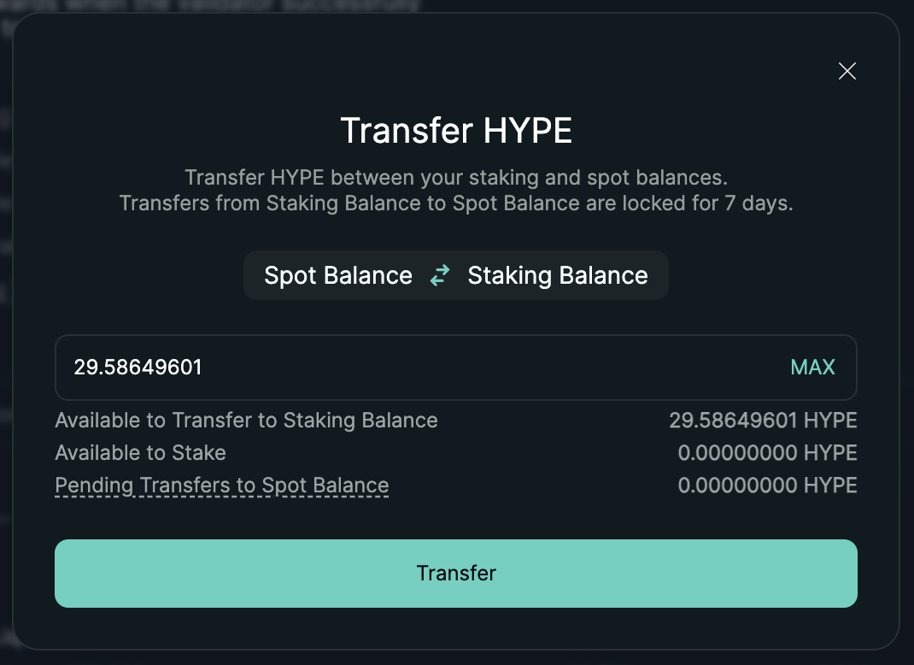

<!-- Source: https://hyperliquid.gitbook.io/hyperliquid-docs/onboarding/how-to-stake-hype -->

> For the complete documentation index, see [llms.txt](https://hyperliquid.gitbook.io/hyperliquid-docs/llms.txt). Markdown versions of documentation pages are available by appending `.md` to page URLs; this page is available as [Markdown](how-to-stake-hype.md).

# How to stake HYPE

You can use different websites to stake HYPE on HyperCore, including:&#x20;

* <https://app.hyperliquid.xyz/staking/>
* <https://stake.nansen.ai/stake/hyperliquid>
* <https://app.validao.xyz/stake/hyperliquid>
* <https://hypurrscan.io/staking>

1. You will need HYPE in your Spot Balance on HyperCore. If you have HYPE on the HyperEVM, you would need to [transfer it from the HyperEVM](how-to-use-the-hyperevm.md#how-do-i-move-assets-to-and-from-the-hyperevm) to HyperCore.
2. Transfer HYPE from your Spot Balance to your Staking Balance.

<figure><figcaption></figcaption></figure>

3. Choose a validator to stake to. Staking to a validator has a 1 day lockup.&#x20;

To unstake, follow the same process in reverse:

1. Unstake from a validator.
2. Transfer from your Staking Balance to your Spot Balance. This takes 7 days.&#x20;
3. After 7 days, the HYPE will appear in your Spot Balance.

For further questions, you can refer to the [Staking](../hypercore/staking.md) section.
